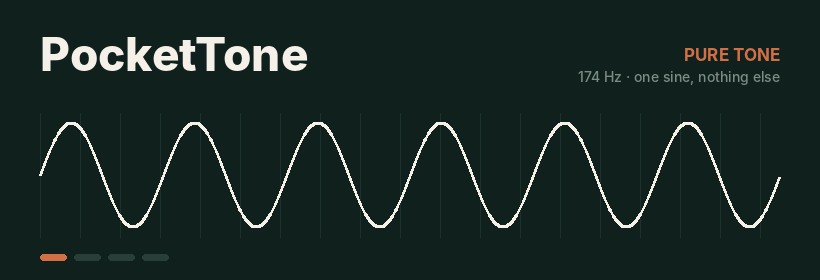
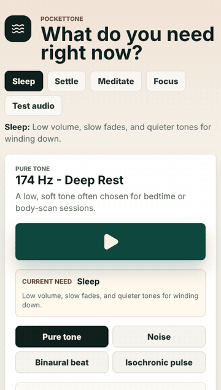
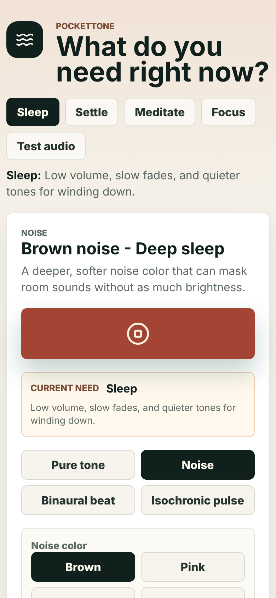
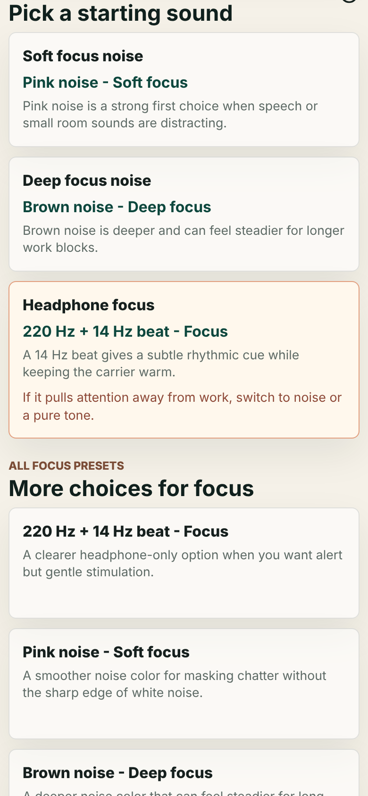
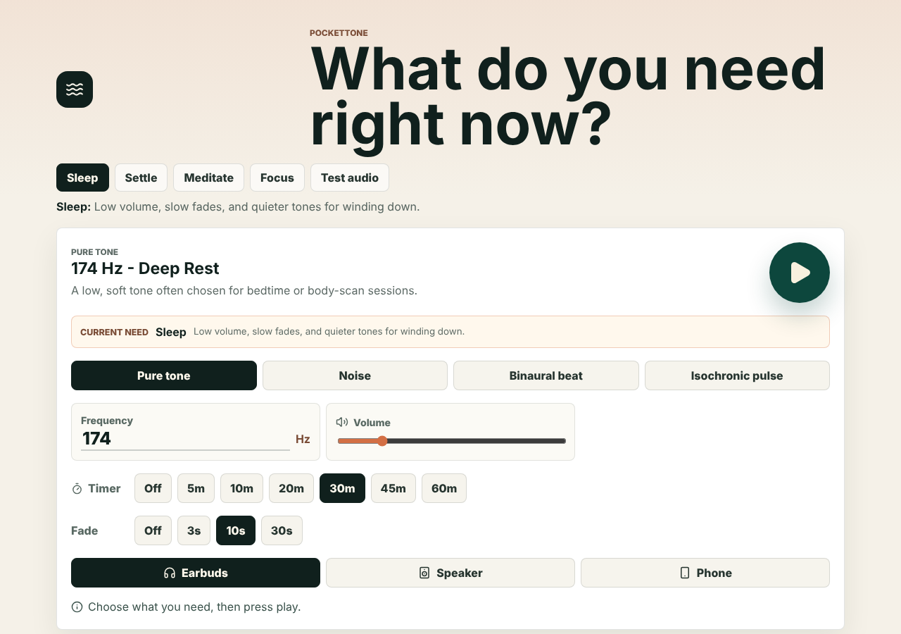

<div align="center">



### A pocket-sized tone generator for sleep, focus, calm and quick audio checks.

**Tap what you need. Press play. Let the room go quiet.**

[](https://pockettone.netlify.app)
[](#install-it)
[](LICENSE)

</div>

---

## Hello, quiet

Most tone apps open with a wall of sliders. PocketTone opens with one question: **what do you need right now?**

Pick **Sleep**, **Settle**, **Meditate**, **Focus** or **Test audio**. PocketTone loads a sensible starting sound, a timer and a fade, so the only thing left to do is press the big round button. Want to tinker? Every frequency, beat, pulse, color, fade and minute is still there underneath.

All of it is generated live in your browser with the Web Audio API. There are no audio files, no streaming, no account and no tracking. It's maths turned into air pressure, right there on your phone.

<div align="center">
  
</div>

## The four voices

| Mode | What you hear | Good for |
| --- | --- | --- |
| **Pure tone** | A single sine wave, the simplest sound there is. No harmonics, no texture, just one frequency. | Meditation anchors, reference pitch, speaker checks |
| **Noise** | Five colors: **brown**, **pink**, **white**, **blue**, **violet**. Each is randomness with a different spectral tilt, from dark and rumbly to bright and airy. | Masking chatter, sleeping through traffic, deep work |
| **Binaural beat** | A slightly different frequency in each ear. Your brain hears a slow "wah-wah" pulse that isn't in either channel. **Headphones required.** | Wind-down rituals, meditation, gentle focus |
| **Isochronic pulse** | One tone whose loudness swells and dips at a steady rate. You can hear the rhythm on any speaker. | Rhythmic focus without needing headphones |

Every session also gets:

- ⏲️ **A sleep timer** (5–60 min) that keeps proper wall-clock time even when your screen is off.
- 🌫️ **Fades** of 0, 3, 10 or 30 seconds, so sound arrives and leaves gently instead of clicking on.
- 🎧 **Output hints** for earbuds, speakers or the phone speaker.
- 📳 **Optional haptics**, a small buzz when you start, stop or choose something.
- 💾 **Memory.** Your last setup is waiting for you next time.

## Screens

<div align="center">
  
  &nbsp;&nbsp;
  
</div>

<div align="center">
  
</div>

## A short history of humming machines

People have been using steady sounds to change how they feel for a very long time. PocketTone stands on some interesting shoulders.

**1711: the tuning fork.** John Shore, a trumpeter who played for Handel, invented the tuning fork. It was the first everyday object that could produce something close to a pure tone: one clean frequency that fades slowly. It was the 18th century's sine wave generator.

**1822: everything is sine waves.** Joseph Fourier showed that any repeating signal can be built by adding sine waves together. That's why the sine is the atom of sound, and why the pure tone mode is just one oscillator.

**1839: the ghost in the stereo.** The Prussian physicist Heinrich Wilhelm Dove noticed that two slightly different tones, one in each ear, produce a beat that neither ear receives on its own. The brain makes it up. That is the binaural beat, discovered nearly 40 years before the telephone.

**1863: a science of hearing.** Hermann von Helmholtz published *On the Sensations of Tone*, which used glass resonators to pick single frequencies out of complex sounds. It's still the foundation of how we think about pitch, timbre and consonance.

**1939–1955: everyone agrees on A.** Orchestras had argued about tuning for centuries. Giuseppe Verdi pushed for a lower pitch near 432 Hz, and Paris had standardized on 435 Hz. An international conference in London settled on **A = 440 Hz** in 1939, and it became the ISO 16 standard in 1955. That's the "440 Hz Reference" preset. The 432 Hz presets nod to the side that lost.

**1962: the white-noise machine.** The first consumer sleep sound machine was a fan in a box that you twisted to change the "whoosh". It sold for decades on one idea: a steady sound bed hides the bumps in the night.

**1973: binaural beats go mainstream.** Biophysicist Gerald Oster's *Auditory Beats in the Brain* in *Scientific American* brought Dove's effect back as a tool for studying how the brain hears. A whole subculture of "brainwave" audio followed.

**Noise gets its colors.** Engineers borrowed a metaphor from light. White noise has equal energy at every frequency, like white light has every color. Tilt the energy toward the low end and it "reddens": pink noise drops 3 dB per octave, and brown noise drops 6 dB. Brown noise isn't named after the color. It's named after Robert Brown, the botanist who watched pollen jitter in water in 1827. Brown noise is literally a random walk, and that's the wandering line in the banner above.

**2021: the browser becomes a synthesizer.** The Web Audio API became a W3C Recommendation, so any modern browser could generate sound sample by sample with no plugins. PocketTone is about 200 years of acoustics running on that API, in your pocket.

> **A note on the mystical numbers.** Frequencies like 174, 396, 432 and 528 Hz come from modern wellness traditions, not from clinical evidence. PocketTone includes them because many people like them as listening rituals. It doesn't claim they heal anything. Enjoy them for how they sound.

## Install it

PocketTone is a Progressive Web App. Once installed, it launches full-screen and **works with no connection at all**, including on a plane, in a tent or in a basement.

- **Android / Chrome / Edge:** tap **Install app** at the bottom of the page, or use the browser menu.
- **iPhone / iPad:** open the site in Safari, tap **Share**, then **Add to Home Screen**.
- **Desktop:** look for the install icon in the address bar.

## Under the hood

```
src/
├── audio/toneEngine.ts     ← Web Audio synthesis: oscillators, stereo merger, LFO, noise buffers
├── App.tsx                 ← the whole UI: needs, player, presets, timer, install
├── data/
│   ├── needs.ts            ← the five "what do you need?" answers
│   ├── presets.ts          ← labelled sounds per need
│   └── recommendations.ts  ← the "Pick a starting sound" cards
├── hooks/                  ← persistent settings, haptics
└── pwa/                    ← service worker registration
public/sw.js                ← offline cache (app shell and hashed bundles)
```

A few details worth knowing:

- **Binaural beats** are two sine oscillators routed into a `ChannelMergerNode`, one per ear. The carrier shifts if it needs to, so both ears stay within 20 Hz–20 kHz and the beat is always the one you asked for.
- **Isochronic pulses** use a sub-audio sine LFO wired straight into a gain node's `AudioParam`.
- **Noise** is generated once into a 6-second looping buffer. Pink noise uses Paul Kellet's filter, brown noise uses a leaky integrator, and blue and violet are first and second differences of white noise. The loop point is crossfaded so brown and pink noise don't click every time the loop wraps.
- **Every change is smoothed** with `setTargetAtTime`, so dragging the volume or retuning mid-session never pops.

Built with React 19, TypeScript, Vite and lucide icons. Deployed as a static site on Netlify.

## Run it locally

```bash
npm install
npm run dev       # http://127.0.0.1:5173
npm run build     # type-check and build to dist/
npm run preview   # serve the production build (service worker enabled)
```

Netlify settings: build command `npm run build`, publish directory `dist`.

## Listen kindly

🔉 **Start quiet**, especially with earbuds. You can always turn it up, but your ears can't take it back.
🎧 Binaural beats only work with headphones. Over a speaker, the two ears' tones just blend.
🩺 PocketTone is a listening tool for rituals, relaxation, focus and audio checks. It isn't a medical device and it doesn't diagnose, treat or promise any health outcome.

<div align="center">

---

*Made with sine waves and a little bit of randomness.* 〰️

[MIT License](LICENSE)

</div>
